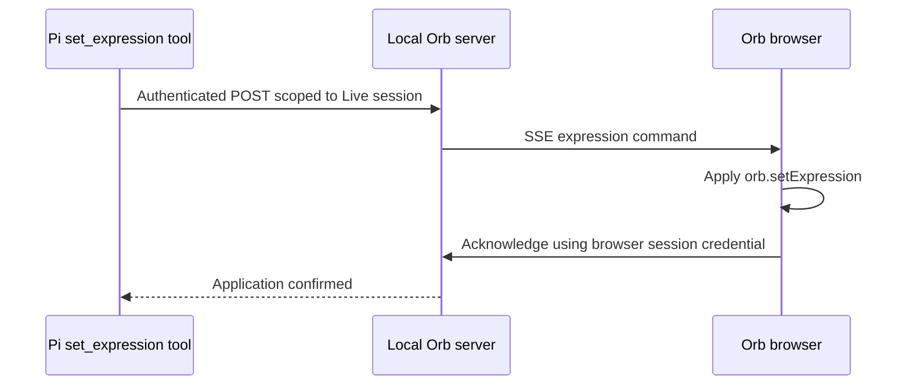

# Ava Voice — GPT-Live with a Pi backend

The browser handles microphone input, WebRTC audio, transcripts, and the Orb. The local server creates GPT-Live sessions with client delegation. The separate `ava-personal-assistant` application attaches to the Live session and runs delegated requests through Pi.

## Starting Ava

Ava runs as two local processes: this Orb server (voice, browser, expressions) and the Pi backend in the `ava-personal-assistant` repository (reasoning and tools). The backend attaches to one specific Live call, so start it after each new call.

### Prerequisites

- Node.js 24 and a browser with microphone access.
- A local checkout of `ava-personal-assistant` with `npm install` run, on a branch that includes the voice tools (`feat/web-search-local-time` or later).
- A Pi provider configured with credentials through Pi. The assistant's `.env` selects it:

  ```dotenv
  AVA_MODEL_PROVIDER=your-provider
  AVA_MODEL_ID=your-model-id
  AVA_MODEL_THINKING_LEVEL=medium
  ```

### One-time setup

Create `voice/.env` in this repository:

```dotenv
OPENAI_API_KEY=your_openai_api_key
AVA_ORB_BRIDGE_TOKEN=your_random_private_bridge_token
```

Generate the bridge token separately, for example with `openssl rand -hex 32` (at least 32 bytes of entropy). Never reuse the OpenAI API key as the bridge token. The browser receives neither value, and `.env` is not committed.

### Each session

1. **Start the Orb server.** From `voice/`:

   ```sh
   node --env-file=.env server.mjs
   ```

   It prints `Ava Voice em http://localhost:3000`.

2. **Start a call.** Open `http://localhost:3000`, allow the microphone, and start the call. Wait for "Conectada. Pode falar." The server terminal prints the call's ID as `[live] sessão <LIVE_SESSION_ID> …`.

3. **Attach the Pi backend.** From the `ava-personal-assistant` repository, with the call still open:

   ```sh
   npm run build
   node --env-file=.env --env-file=/absolute/path/to/ava-orb/voice/.env dist/voice-preview.js "<LIVE_SESSION_ID>"
   ```

   The first file supplies the Pi model settings. The second supplies the same `OPENAI_API_KEY` as the Live session and the shared bridge token. On success it prints `Voice Pi session:` and `Session file:`.

4. **Talk to Ava.** Delegated requests (time, web search, expressions) now run through Pi. Try "Ava, que horas são em São Paulo?"

To end, stop the call in the browser, then stop the backend with Ctrl+C. A new call has a new Live session ID, so repeat steps 2 and 3. A backend attached to an ended call cannot be reused.

Troubleshooting:

- **Delegated requests get no answer:** check that the backend is running and was started with the current call's ID.
- **The backend exits with a 503:** retry later, or start a new call and use its ID.
- **Expressions do not change:** `AVA_ORB_BRIDGE_TOKEN` is missing or differs between the two processes. Restart both and start a new call.
- **The server exits with "OPENAI_API_KEY não definida":** run it with `--env-file=.env` from `voice/`.

### Configuration

| Variable | Default | Purpose |
| --- | --- | --- |
| `OPENAI_API_KEY` | Required | Creates the Live session; remains on the server. |
| `AVA_VOICE_MODEL` | `gpt-live-1` | Voice model. |
| `AVA_VOICE` | `Vesper` | Voice selection. |
| `PORT` | `3000` | Local Orb HTTP port. |
| `AVA_ORB_BRIDGE_TOKEN` | Unset | Shared server credential enabling expression commands. |
| `AVA_ORB_BRIDGE_URL` | `http://127.0.0.1:3000` | Used by the Pi backend; change it if the Orb port changes. |

The commented Responses-delegation example in `server.mjs` is inactive. `AVA_BACKEND_MODEL` does not select the current Pi model; use `AVA_MODEL_PROVIDER` and `AVA_MODEL_ID` in the assistant project. The matching `feat/web-search-local-time` backend enables `get_local_time` and `web_search` as native Pi tools.

## Time and web search

The Orb delegates current date/time questions and web research to the Pi backend. `get_local_time` reads a fresh timestamp in `America/Sao_Paulo`. `web_search` makes a separate OpenAI Responses request with hosted search, using the backend's `OPENAI_API_KEY` and `AVA_WEB_SEARCH_MODEL` (default `gpt-6-astra`). Search incurs model/search API usage and does not depend on `AVA_ORB_BRIDGE_TOKEN`.

Restart both applications, reload the browser, and start a new call. Ask "Ava, use get_local_time e me diga a hora em São Paulo" or "Ava, pesquise uma notícia recente sobre exploração espacial e cite a fonte". Source URLs relayed by GPT-Live are clickable in the transcript; HTML from transcripts is never interpreted. Link presence depends on GPT-Live preserving the backend's citations. These two new live flows still need manual validation.

## Expression flow



- `expression-bridge.mjs` routes commands to the browser that owns the Live session. An ephemeral browser credential is returned during session creation; the shared bridge token stays on the servers.
- `expression-client.mjs` receives commands, validates the expression and duration, applies them, and acknowledges each request. It preserves an explicit expression against automatic speech expressions until the duration ends. A newer explicit command may replace it.
- `voice.js` connects and closes the expression stream alongside the voice call. Its existing audio measurement and transcript rendering remain in place.
- Pi continues to own the tool schema, model requests, tool execution, and conversation history. Application UI events are separate from GPT-Live events.

Allowed expressions: `neutra`, `atenta`, `pensativa`, `feliz`, `surpresa`, `sonolenta`, `piscadinha`, `triste`, and `desconfiada`. Duration defaults to 3000 ms and must be an integer from 800 to 15000 ms. Existing speech-based automatic expressions continue when no explicit expression is active.

To test by voice, say: "Ava, use set_expression para fazer uma piscadinha por cinco segundos."

Restart the server and reload the page after updating. Start a new voice session so its browser credential and expression stream are created. Without `AVA_ORB_BRIDGE_TOKEN`, voice still works but the bridge and Pi expression tool remain disabled.

## Failures and lifetime

An unattached browser session expires after 30 seconds. A disconnected stream removes its session and rejects outstanding requests. A command expires after 5 seconds without acknowledgement; the backend HTTP timeout is 6 seconds. Expired commands are not applied by the browser. Start a new voice call after an expression-connection failure.

Acknowledgement confirms a call to the Orb rendering API, not that the user saw the expression. A lost acknowledgement or aborted request can leave the result unknown. Neither side retries commands automatically, and abort cannot undo an already applied expression. This bridge is for the existing local, single-user application.

## Local validation

From the Orb repository root:

```sh
node --test voice/*.test.mjs
```

Five tests cover authentication, session isolation, acknowledgement, invalid input, timeout, browser disconnect, duration, and browser cleanup. They use local HTTP/SSE and injected rendering callbacks, without calling OpenAI or requesting microphone access. A cross-project integration smoke test also exercised the Pi tool through the real local HTTP/SSE transport.

On 2026-10-12, the owner followed the voice test above and confirmed that `set_expression` worked in a live call. This is owner-reported manual validation, separate from the automated checks.

Three additional tests cover transcript links: safe Markdown/bare-URL rendering, text accumulated across deltas, and unsupported URL schemes. The Orb suite now has eight tests.
